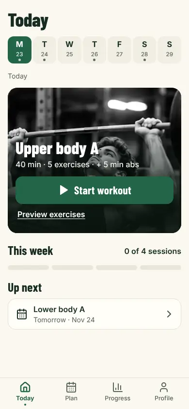
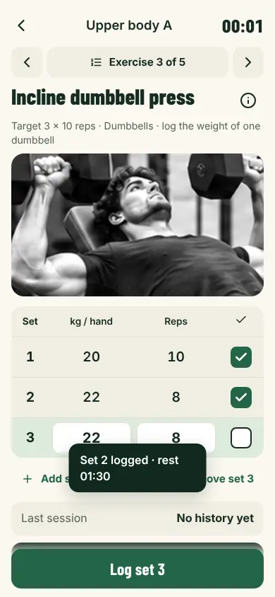
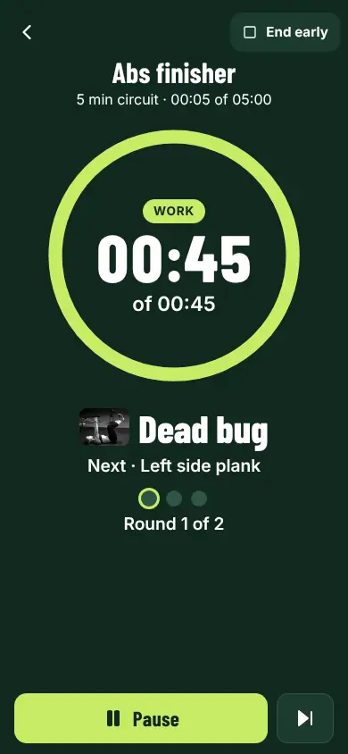
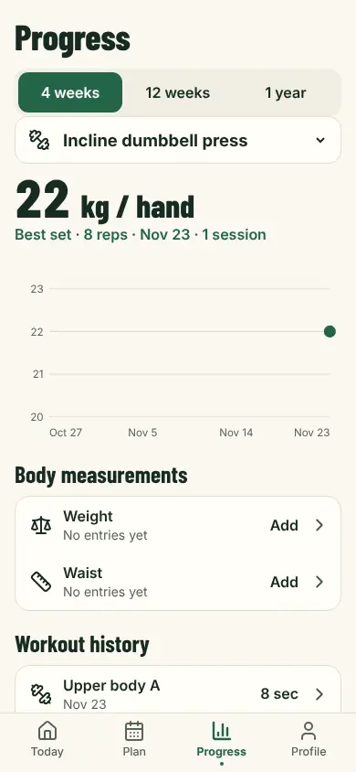

# Workout Tracker

A mobile-first, local-first workout tracker built from `Workout_App_UI.pdf`. It uses React, TypeScript and Vite and ships as an installable web app (PWA). There is no account, API key, server or paid service. Everything is stored on the device in IndexedDB and works offline after the first load.

It lives in its own folder and does not touch the HR or hospitality apps elsewhere in this repository.

| Today | Live workout | Abs finisher | Progress |
| --- | --- | --- | --- |
|  |  |  |  |

## Run it

Requires Node.js 20 or newer.

```sh
cd workout
npm install
npm run dev          # development server on http://localhost:5173
```

Production build (this is what gets installed and works offline):

```sh
npm run build        # type-checks, then writes dist/
npm run preview      # serves dist/ on http://localhost:4173
```

### Use it on your phone (bookmark / Add to Home Screen)

Service workers, and therefore offline use, need **HTTPS** (or `localhost`). The `dist/` folder is plain static files, so any static host works: GitHub Pages, Netlify, Cloudflare Pages, a Render static site, or your own server. The build uses relative paths, so it also works from a sub-folder such as `https://you.github.io/workout/`.

1. Run `npm run build` and upload the **contents** of `dist/`.
2. Open the URL once on the phone while online so the app shell and all exercise photos are cached.
3. **iPhone (Safari):** Share → *Add to Home Screen*. **Android (Chrome):** menu → *Install app* or *Add to Home screen*.

You can open the dev server from a phone on the same Wi-Fi via `http://<computer-ip>:5173`, but offline caching will not activate over plain HTTP.

> Safari can clear site data for web pages that haven't been opened for several weeks unless the app was added to the Home Screen. Add it to the Home Screen, and use **Profile → Settings → Export workout data** for backups.

## Tests

```sh
npm test             # unit tests: domain rules + IndexedDB commit-once (Vitest, fake-indexeddb)
npm run build && npm run preview &
npm run e2e          # 55 browser checks across the five acceptance flows → e2e-output/
```

`npm run e2e` needs the `playwright` package and a Chromium (`npx playwright install chromium`). Set `PW_CHROMIUM=/path/to/chromium` to use an existing browser. See [VERIFICATION.md](VERIFICATION.md) for the latest results.

## What's inside

| Area | Where |
| --- | --- |
| Data model (sessions, sets, timers, templates, plans, measurements) | `src/domain/types.ts` |
| Starter routines, schedule versions, one-date vs recurring moves, weekly targets | `src/domain/plan.ts` |
| Live session rules: prefill, validation, log/edit sets, rest timer, best set | `src/domain/session.ts` |
| Abs finisher timeline (2 rounds × 3 stations × (5 s + 45 s) = 5:00) | `src/domain/finisher.ts` |
| Progress series (heaviest set, rep tie-break, bodyweight reps, timed holds) | `src/domain/progress.ts` |
| Units (kg/lb, cm/in, stored as kg/cm) and CSV/ZIP export | `src/domain/units.ts`, `csv.ts`, `zip.ts` |
| IndexedDB stores and the exactly-once session commit | `src/data/db.ts` |
| App state, write-through persistence, save-failure retry | `src/data/store.ts` |
| Per-tab navigation stacks, back guard, scroll restore | `src/nav/router.ts` |
| The 16 screens and their sheets | `src/screens/*` |
| Exercise library (28 movements, each with its own photo, alt text and cues) | `src/domain/exercises.ts`, `public/exercises/` |

### Key behaviours

- **One record everywhere.** Today, the plan, the preview and the editor all read the same template, and estimated duration comes from one function. A started session snapshots the template, so History, Progress and the summary all read the same saved session.
- **Versioned templates.** Saving an edit creates a new version. Completed sessions keep the exercises, targets and title they were performed with.
- **Schedule changes.** *Move → This date only* writes a one-date override. *Every week from …* adds a new recurring schedule version from that date, so earlier weeks are unchanged. Changing the weekly goal records a new target from the current week, and past weeks keep the target they had.
- **Resumable session.** Every keystroke, logged set, exercise position and timer change is written to IndexedDB. Timers are stored as timestamps plus accumulated pause time, so after a reload or a locked phone they reconcile elapsed time. A finisher that ran out while you were away is marked complete at exactly 5:00.
- **Save exactly once.** Save runs in one IndexedDB transaction that refuses to commit an already-completed session id, and repeated taps share one in-flight save. If the write fails, the draft stays and a **Retry** banner appears.
- **Units.** Loads are stored in kilograms (per hand for dumbbells, flagged by `loadConvention`) and lengths in centimetres, at full precision. Switching units only changes display and entry.
- **Export.** One ZIP containing `workouts.csv`, `sets.csv`, `finishers.csv` and `measurements.csv`, or each file separately. Every row has a date, plus both the displayed value with its unit and the stored canonical value with its unit.

Asset sources and licences are in [ASSETS.md](ASSETS.md).
